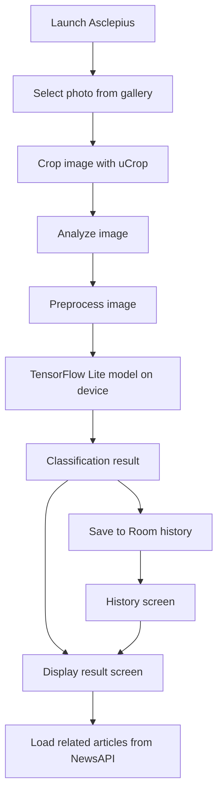
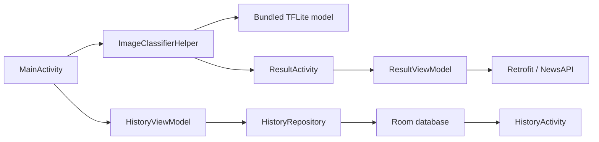

# Asclepius

**An Android image-classification app powered by on-device TensorFlow Lite inference.**

Asclepius is a native Android learning project created for **Dicoding — Belajar Penerapan Machine Learning untuk Android**. It demonstrates an end-to-end image classification experience: choose a photo, crop it, run a bundled machine-learning model locally, review the classification output, and revisit earlier results. A related-articles section retrieves cancer-related news through an external API.

**Tech focus:** Kotlin · Android Views / View Binding · TensorFlow Lite Task Vision · Room · Retrofit

> [!IMPORTANT]
> **Educational demonstration only — not a medical device.** The bundled model is named `cancer_classification.tflite`, but this repository does not establish clinical validation, diagnostic accuracy, or suitability for medical decision-making. A model score is a classification confidence score, **not** a medical diagnosis or calibrated probability of disease. Do not use results to decide whether to seek or avoid healthcare.

## Overview

Integrating ML into an Android application involves more than loading a model. Asclepius brings together image input, preprocessing, local inference, result presentation, persistence, and remote content in one application.

The image classifier runs **on the device** using a bundled TensorFlow Lite model. Internet connectivity is used for the separate article/news feature; the classification path itself does not call a hosted inference API.

### Features

| Feature | Implementation |
| --- | --- |
| Gallery image picker | Selects an image using the Android Photo Picker API |
| Image cropping | Opens **uCrop** to adjust the selected image before analysis |
| On-device classification | Executes `cancer_classification.tflite` via TensorFlow Lite Task Vision |
| Classification results | Displays model-provided class label(s) and confidence score(s) |
| Analysis history | Saves the result text, image URI, and analysis date in local **Room** storage |
| History screen | Lists past analyses and opens the stored result view |
| Related articles | Loads news matching the query `cancer` from **NewsAPI** using Retrofit |
| Loading indicators | Uses shimmer placeholders while article data is loading |

### App flow



The classification and news features are separate: **NewsAPI content does not affect the TensorFlow Lite prediction**.

## Machine learning pipeline

The application includes the model file at [`app/src/main/ml/cancer_classification.tflite`](app/src/main/ml/cancer_classification.tflite). Its classifier is initialized in [`ImageClassifierHelper.kt`](app/src/main/java/com/dicoding/asclepius/helper/ImageClassifierHelper.kt).

| Step | Current implementation |
| --- | --- |
| Input | Image selected from the device's photo library |
| Cropping | uCrop, with a 16:9 aspect ratio and maximum output size of 2000 × 2000 |
| Decoding | `ImageDecoder` on supported devices; legacy `MediaStore` path otherwise |
| Preprocessing | Resize to **224 × 224** using nearest-neighbor interpolation, then cast to **UINT8** |
| Inference | `org.tensorflow.lite.task.vision.classifier.ImageClassifier` |
| Runtime options | **4** interpreter threads, **0.1** score threshold, up to **3** returned results |
| Output | Model category label and score shown as a percentage in the result interface |

The code takes labels and scores from the model's output rather than hardcoding diagnostic categories. The model's training dataset, quantitative evaluation metrics, and clinical performance are **not documented in this repository**, so this README does not claim an accuracy figure.

## Architecture

Asclepius uses Android activities and ViewModels with separate helpers for inference, a repository for local history, and a Retrofit client for remote articles.



**Local persistence:** The `history` entity stores an auto-generated ID, date, result string, and image URI. History is kept in the application's local Room database (`asclepius_database`). Stored URI access and image availability can depend on platform behavior and the original image file's lifecycle.

**Remote articles:** `ResultViewModel` requests recent matching news from the NewsAPI `everything` endpoint using the `cancer` keyword and `publishedAt` sort order. News cards show titles and images and open article URLs in the browser.

## Technology stack

| Area | Technology |
| --- | --- |
| Platform | Android, Kotlin |
| UI | Android Views, XML layouts, View Binding, Material Components |
| Machine learning | TensorFlow Lite Task Vision, TensorFlow Lite Support |
| Image selection | Android Photo Picker |
| Image editing | uCrop |
| Local database | Room 2.6.1 |
| State and lifecycle | ViewModel, LiveData, Kotlin Coroutines |
| Networking | Retrofit 2.9, OkHttp, Gson |
| Image loading | Glide |
| Loading effects | Facebook Shimmer |
| Build | Gradle 8.2, Android Gradle Plugin 8.2.0, Kotlin 1.9.22 |

Project Android configuration:

- `minSdk = 24` — Android 7.0+
- `compileSdk = 34` and `targetSdk = 34`
- `applicationId = "com.dicoding.asclepius"`
- View Binding and ML Model Binding enabled

## Getting started

### Requirements

- **Android Studio** with Android SDK Platform 34 installed
- **JDK 17** compatible with Android Gradle Plugin 8.2
- Android device or emulator with API level 24 or above
- Internet connection **for related articles**; on-device ML inference does not require network access

### Run locally

```bash
git clone https://github.com/alfrzhb/Asclepius.git
cd Asclepius
```

1. Open the cloned directory in Android Studio.
2. Ensure Android Studio has generated a valid local `local.properties` containing your Android SDK path. The app's Gradle script reads this file during configuration.
3. Allow Gradle to sync and download dependencies.
4. Select an emulator or physical Android device.
5. Run the **app** configuration.

Alternatively, from a correctly configured Android SDK/JDK environment:

```bash
# macOS / Linux
./gradlew assembleDebug

# Windows
gradlew.bat assembleDebug
```

The debug APK is normally generated under `app/build/outputs/apk/debug/`.

> The commands above are the project's standard build steps. This README-only change has **not** run an Android build or verified execution on a device.

### Try the analysis flow

1. Launch the app and select **Add Image**.
2. Pick a photo using the system picker.
3. Crop it and confirm the crop operation.
4. Select **Let's Analyze** to run the bundled classifier.
5. Review the classification output and related article section.
6. Open **History** from the app menu to revisit saved analyses.

For meaningful testing, use images and class labels appropriate for the bundled educational model. The repository does not provide a validated medical testing protocol.

## Project structure

```text
app/src/main/
├── ml/
│   └── cancer_classification.tflite   # Bundled on-device ML model
├── java/com/dicoding/asclepius/
│   ├── helper/
│   │   └── ImageClassifierHelper.kt    # TFLite setup and inference
│   ├── data/
│   │   ├── local/                     # Room entity, DAO, database
│   │   └── remote/                    # News response, Retrofit, state
│   ├── repository/
│   │   └── HistoryRepository.kt       # Local history access
│   ├── utils/                         # List adapters, ViewModel factory
│   └── view/
│       ├── SplashScreenActivity.kt
│       ├── MainActivity.kt            # Picker, crop, classify
│       ├── result/                    # Result screen + news ViewModel
│       └── history/                   # History screen + ViewModel
└── res/
    ├── layout/                        # Android XML layouts
    ├── drawable/                      # Image and UI assets
    └── values/                        # Colors, text, themes
```

## Current limitations and engineering notes

This repository is a learning submission. The features above are **implemented in source code**, not independently validated against a released APK.

- **API key handling needs attention.** The NewsAPI credential is written directly into the tracked Gradle build configuration and is compiled into the app. It should be considered exposed, **rotated**, and replaced with an appropriate approach. Moving it to `local.properties` alone does not keep a key secret once embedded in a distributed client APK. A trusted server-side proxy is more appropriate if confidentiality is required.
- **Network-dependent articles may fail.** NewsAPI availability, rate limits, key validity, and response handling can affect this optional feature; not all error types are currently handled.
- **Classification isn't clinically validated.** The repository does not establish model provenance, test-set metrics, calibration, or acceptable medical use.
- **History currently uses main-thread database access** (`allowMainThreadQueries()`); migrating reads to asynchronous DAO functions would improve responsiveness.
- **Image permissions and URI handling** should be revisited for current Android versions, particularly the legacy external-storage permission request alongside the Photo Picker.
- **Automated tests are placeholders.** Basic Android unit/instrumentation example tests exist, but there are no demonstrated model-accuracy, UI-flow, or repository integration tests in the inspected code.
- **No screenshots or deployment release** have been verified from repository assets. This README intentionally does not invent application screenshots or distribution links.

### Potential next improvements

1. Remove and rotate exposed API credentials, then separate optional article loading from classification reliability.
2. Add proper error/empty-state handling for both inference and remote articles.
3. Refactor Room access to coroutines and observable database queries.
4. Improve photo-picker permissions and persistence of result images/URIs.
5. Add deterministic classifier tests, Room tests, and Android UI tests.
6. Document model provenance and evaluation before making stronger accuracy claims.

## License and acknowledgment

The repository includes an [Apache License 2.0](LICENSE) file. This project was developed as a **Dicoding Android machine-learning learning submission** and uses third-party libraries and a bundled model subject to their own applicable terms.

**Maintainer:** [alfrzhb](https://github.com/alfrzhb) · **Source:** [alfrzhb/Asclepius](https://github.com/alfrzhb/Asclepius)
